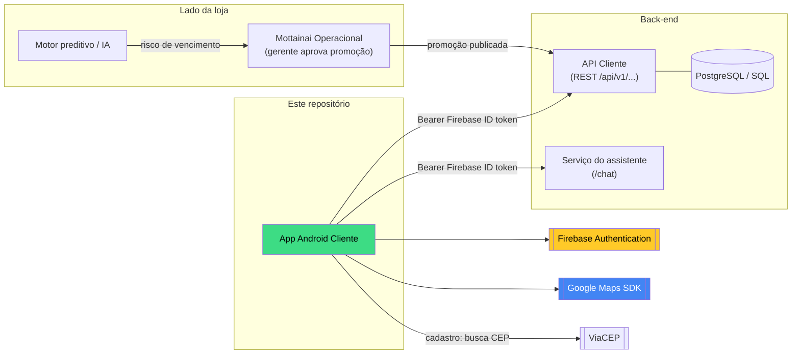
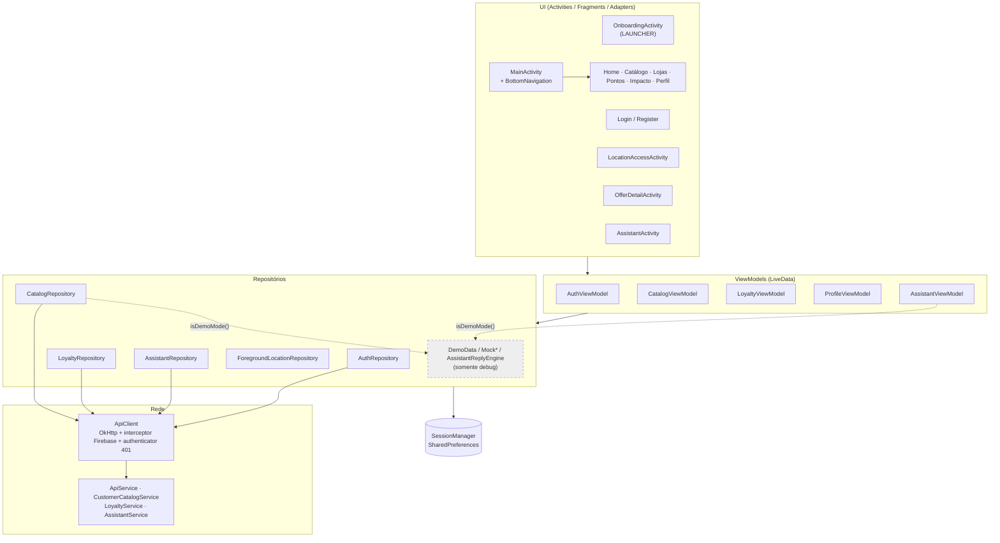
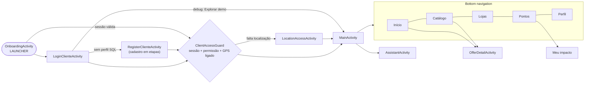
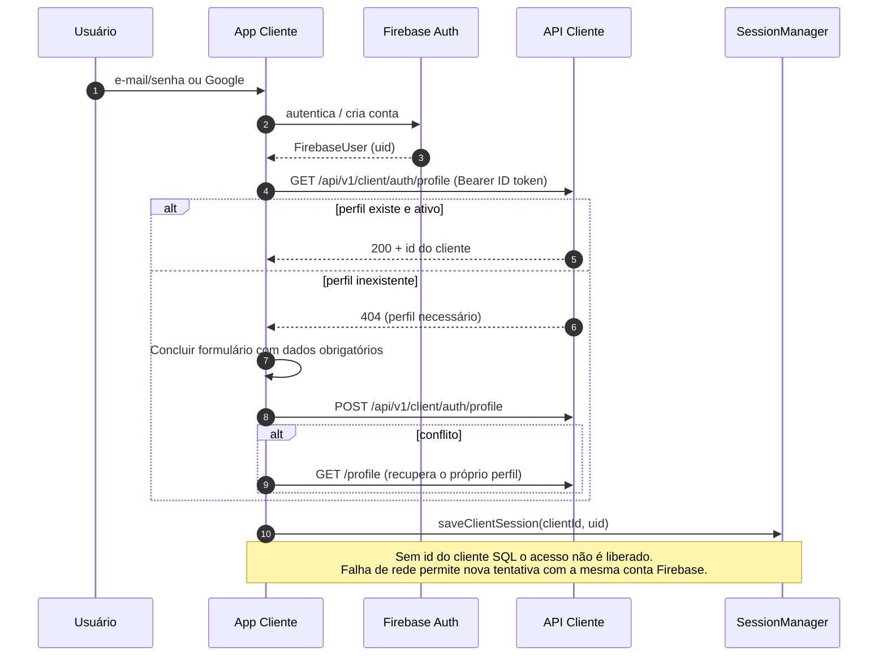
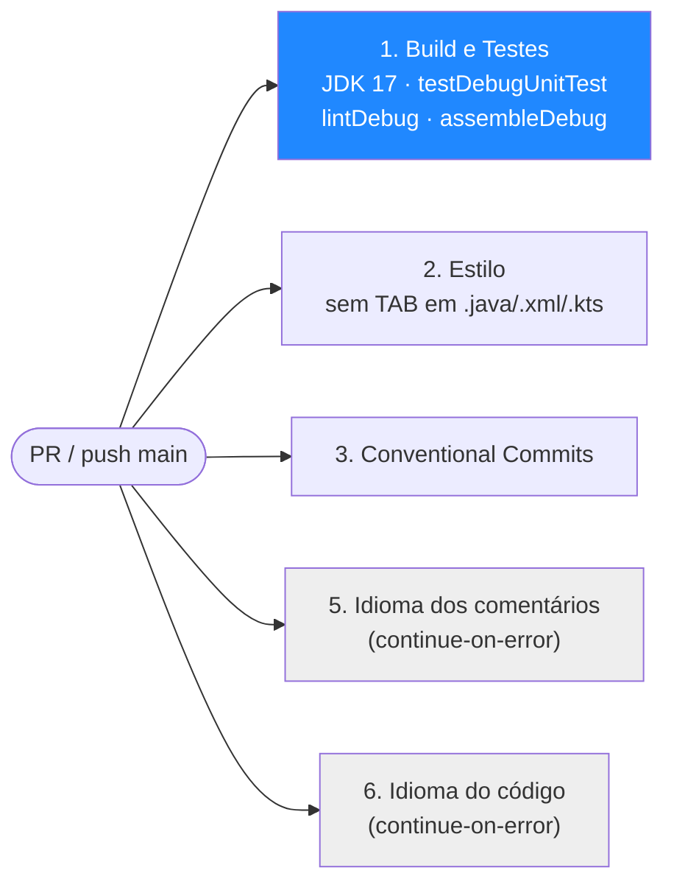

<div align="center">

# Mottainai Mobile Cliente

**Aplicativo Android do consumidor final: vitrine de ofertas de mercados parceiros e fidelidade no ecossistema Mottainai**

*Ofertas, lojas, pontos e assistente, com autenticação Firebase e clientes HTTP para os serviços configurados; a homologação depende das integrações disponíveis.*

<br/>

[](app/build.gradle.kts)
[-ED8B00?style=for-the-badge&logo=openjdk&logoColor=white)](app/build.gradle.kts)
[](gradle/libs.versions.toml)
[](gradle/libs.versions.toml)

[](gradle/libs.versions.toml)
[-02303A?style=flat-square&logo=gradle&logoColor=white)](gradle/wrapper/gradle-wrapper.properties)
[](gradle/libs.versions.toml)
[](gradle/libs.versions.toml)
[](.github/workflows/ci.yml)
[](#11-status-riscos-e-limitações)

<br/>

[Visão geral](#1-visão-geral) •
[Ecossistema](#2-papel-no-ecossistema) •
[Arquitetura](#3-arquitetura) •
[Tecnologias](#4-tecnologias) •
[Funcionalidades](#6-funcionalidades-e-fluxos) •
[Integrações](#7-integrações-e-contratos-de-api) •
[Configuração](#8-configuração-e-execução) •
[Testes e CI](#9-testes-e-integração-contínua) •
[Segurança](#10-segurança-e-privacidade) •
[Status](#11-status-riscos-e-limitações)

</div>

---

## 1. Visão geral

O **Mottainai** (もったいない, *"que desperdício"*) é um sistema de gestão preditiva de estoque para pequenos e médios varejos. Este repositório contém o **app Android do cliente final** (pacote `com.mottainai.cliente`), a ponta do ecossistema que transforma a decisão da loja ("vamos dar desconto neste lote que vai vencer") em oferta visível para o consumidor.

| | Princípio | Como aparece no código |
|---|---|---|
| **1** | **App não acessa banco** | No fluxo real, os dados de negócio são requisitados a APIs REST via Retrofit (`network/`); o modo demonstração usa dados locais. Não há Room/SQLite. |
| **2** | **Firebase só para identidade** | Apenas `firebase-auth` é dependência. O perfil é gravado no SQL pela API (`POST/PUT api/v1/client/auth/profile`). |
| **3** | **Sessão mínima no aparelho** | `SessionManager` guarda só `client_id`, `firebase_uid` e flags. Não persiste senha nem token (remove a chave legada `auth_token`). |
| **4** | **Sem cálculo de pontos no app** | Saldo e extrato vêm de `api/v1/client/loyalty/*`; o app apenas apresenta. |
| **5** | **Sem modo offline** | Decisão documentada no README original; não há cache local de catálogo. |
| **6** | **Dados fictícios só em debug** | `isDemoMode()` exige `BuildConfig.DEBUG`; release nunca entra em demonstração. |

> [!NOTE]
> Este README documenta o estado do app na branch **`main` no commit `1bf4112`** (merge da PR #20, 27/10/2026), com revisão das PRs em 28/10/2026. As branches legadas foram comparadas com a versão integrada; a ordem recomendada para as mudanças restantes é **PR #18 (CI) → PR #22 (este README)**.

---

## 2. Papel no ecossistema



| Dependência | Tipo | Confirmado em |
|---|---|---|
| API Cliente (perfil, catálogo, fidelidade) | REST, base em `MOTTAINAI_API_BASE_URL` | `network/ApiService.java`, `CustomerCatalogService.java`, `LoyaltyService.java` |
| Serviço do assistente (IA) | REST, base em `MOTTAINAI_ASSISTANT_BASE_URL` | `network/AssistantService.java` |
| Firebase Authentication | SDK (BoM 34.19.0) | `gradle/libs.versions.toml` |
| Google Maps | SDK `play-services-maps` 20.0.0 + intent/URL do app Maps | `widgets/PartnerMapView.java`, `utils/MapNavigation.java` |
| ViaCEP | REST público, URL fixa `https://viacep.com.br/` | `repository/AuthRepository.java` |

> [!NOTE]
> **Qual repositório implementa a API Cliente não é confirmado pelo código.** A documentação (`docs/delivery-status.md`) cita uma PR no repositório `Mottainai-Spring-Api-SQL` para a edição de perfil; o serviço `/chat` é, por inferência, a camada de IA do ecossistema (não analisada aqui).

---

## 3. Arquitetura

O app segue **MVVM com repositórios**, em Java, com Views XML + View Binding e uma única `MainActivity` hospedando fragments via Navigation Component.



### Decisões visíveis no código

| Tema | Implementação | Arquivo |
|---|---|---|
| Injeção do token | `FirebaseTokenInterceptor` adiciona `Authorization: Bearer <ID token>` e aborta se o UID mudou durante a requisição | `network/ApiClient.java` |
| 401 | `FirebaseTokenAuthenticator` renova o token uma vez; sem usuário, expira a sessão local. O assistente usa um cliente que **não** derruba a sessão SQL no próprio 401 | `network/ApiClient.java` |
| Timeouts | Perfil: 5 s conexão / 10 s leitura / 20 s total, **sem** retry automático (evita POST duplicado). Demais: 10 / 20 / 40 s com retry | `network/ApiClient.java` |
| Base URL | Vem de `BuildConfig`, normalizada para terminar em `/`; vazia lança erro e o repositório fica "não configurado" | `ApiClient.java`, `*Repository.java` |
| Localização | `LocationManager` do framework (`LocationManagerCompat`), apenas em primeiro plano; sem `play-services-location` | `repository/ForegroundLocationRepository.java` |
| Imagens | Glide 4.16.0, URL HTTPS opcional vinda da API, com placeholder | `utils/ProductImages.java`, `ProductImageSource.java` |
| Telefone | `PhoneNumberFormattingTextWatcher("BR")` criado fora da main thread | `utils/InputMasks.java` |

---

## 4. Tecnologias

<table>
<tr>
<td align="center" width="140"><br/><b>Android SDK</b><br/><sub>compileSdk 36<br/>minSdk 26 · targetSdk 36</sub></td>
<td align="center" width="140"><br/><b>Java 11</b><br/><sub>source/target<br/>compatibility</sub></td>
<td align="center" width="140"><br/><b>Gradle 9.1.0</b><br/><sub>Kotlin DSL + AGP 9.0.1<br/>Version Catalog</sub></td>
<td align="center" width="140"><br/><b>Firebase Auth</b><br/><sub>BoM 34.19.0<br/>e-mail/senha + Google</sub></td>
</tr>
<tr>
<td align="center" width="140"><br/><b>Retrofit / OkHttp</b><br/><sub>2.11.0 / 4.12.0<br/>Gson converter</sub></td>
<td align="center" width="140"><br/><b>Google Maps</b><br/><sub>play-services-maps<br/>20.0.0</sub></td>
<td align="center" width="140"><br/><b>Credential Manager</b><br/><sub>credentials 1.3.0<br/>googleid 1.1.1</sub></td>
<td align="center" width="140"><br/><b>GitHub Actions</b><br/><sub>build, lint, testes<br/>e convenções</sub></td>
</tr>
</table>

<details>
<summary><b>Todas as dependências declaradas (<code>gradle/libs.versions.toml</code>)</b></summary>

<br/>

| Grupo | Biblioteca | Versão |
|---|---|---|
| Build | `com.android.application` (AGP) | 9.0.1 |
| Build | `com.google.gms.google-services` | 4.5.0 |
| UI | `androidx.appcompat:appcompat` | 1.7.1 |
| UI | `com.google.android.material:material` | 1.14.0 |
| UI | `androidx.activity:activity` | 1.13.0 |
| UI | `androidx.constraintlayout:constraintlayout` | 2.2.1 |
| UI | `androidx.recyclerview:recyclerview` | 1.3.2 |
| UI | `androidx.cardview:cardview` | 1.0.0 |
| Navegação | `androidx.navigation:navigation-fragment` / `-ui` | 2.8.9 |
| Arquitetura | `androidx.lifecycle:lifecycle-viewmodel` / `-livedata` | 2.9.4 |
| Rede | `com.squareup.retrofit2:retrofit` / `converter-gson` | 2.11.0 |
| Rede | `com.squareup.okhttp3:okhttp` | 4.12.0 |
| Imagens | `com.github.bumptech.glide:glide` | 4.16.0 |
| Auth | `com.google.firebase:firebase-bom` → `firebase-auth` | 34.19.0 |
| Auth | `androidx.credentials:credentials` / `-play-services-auth` | 1.3.0 |
| Auth | `com.google.android.libraries.identity.googleid:googleid` | 1.1.1 |
| Mapas | `com.google.android.gms:play-services-maps` | 20.0.0 |
| Teste | `junit:junit` | 4.13.2 |
| Teste | `androidx.test.ext:junit` | 1.3.0 |
| Teste | `androidx.test.espresso:espresso-core` | 3.7.0 |

Fonte tipográfica DM Sans empacotada em `res/font`, com licença OFL em `app/src/main/assets/licenses/DM-Sans-OFL.txt`.

</details>

---

## 5. Estrutura do repositório

```text
Mottainai-Mobile-Cliente/
├── .github/workflows/ci.yml          # Build/lint/testes + estilo + commits + idioma
├── app/
│   ├── build.gradle.kts              # SDKs, BuildConfig fields, dependências
│   ├── proguard-rules.pro            # Padrão (minify desligado em release)
│   └── src/
│       ├── main/
│       │   ├── AndroidManifest.xml   # Permissões, activities, meta-data do Maps
│       │   ├── java/com/mottainai/cliente/
│       │   │   ├── MainActivity.java
│       │   │   ├── activities/       # Onboarding, Login, Register, LocationAccess, OfferDetail, Assistant
│       │   │   ├── fragments/        # Home, Catalog, Stores, Points, Impact, Profile
│       │   │   ├── adapters/         # Offer, Store, PointsActivity, Chat
│       │   │   ├── viewmodel/        # Auth, Catalog, Loyalty, Profile, Assistant
│       │   │   ├── repository/       # Repositórios reais + DemoData/Mock* (debug)
│       │   │   ├── network/          # ApiClient, 4 interfaces Retrofit, dto/
│       │   │   ├── models/           # Offer, OfferRadius, PartnerStore, UserProfile…
│       │   │   ├── utils/            # SessionManager, CpfValidator, InputMasks, Maps…
│       │   │   └── widgets/          # PartnerMapView
│       │   ├── res/                  # 22 layouts, nav_graph, bottom_nav_menu, temas claro/escuro
│       │   └── assets/licenses/
│       ├── debug/AndroidManifest.xml # usesCleartextTraffic=true (só debug)
│       ├── test/                     # 16 classes JUnit (81 @Test)
│       └── androidTest/              # UiIntegrationTest (2 @Test, Espresso)
├── docs/                             # 10 documentos funcionais/técnicos (ver seção 12)
├── gradle/ (libs.versions.toml, wrapper/)
├── build.gradle.kts · settings.gradle.kts · gradle.properties
├── gradlew · gradlew.bat
├── CHANGELOG.md
└── README.md
```

---

## 6. Funcionalidades e fluxos

### Navegação



### Módulos

| Módulo | O que faz | Fonte de dados | Estado na `main` |
|---|---|---|---|
| **Onboarding** | Introdução e roteamento inicial | Local (`onboarding_done`) | Implementado |
| **Login** | E-mail/senha e Google (Credential Manager), recuperação de senha, retomada de sincronização | Firebase Auth + `GET /profile` | Implementado |
| **Cadastro** | Etapas com máscaras de CPF/CEP/nascimento/telefone, validação de dígitos do CPF, CEP via ViaCEP | Firebase Auth + `POST /profile` | Implementado |
| **Acesso à localização** | Exige permissão e GPS ligado antes dos serviços reais; sem *background location* | `LocationManager` | Implementado |
| **Home** | Saudação, saldo, mapa e cards de ofertas | Catálogo + fidelidade + perfil | Implementado |
| **Catálogo / Detalhe** | Promoções paginadas, busca, filtro por loja, rota no Google Maps | `customer-catalog/promotions` | Implementado |
| **Lojas** | Lista + mapa com pins, raio 5/10/15/20 km (padrão 5) | `customer-catalog/stores?latitude&longitude&radiusKm` | Implementado; raio **não** persistido |
| **Pontos / Impacto** | Saldo, extrato em janelas mensais, status de fidelidade | `client/loyalty/*` | Implementado; métricas ambientais removidas |
| **Perfil** | Leitura/edição, sair da conta, escolha de raio na sessão | `GET/PUT /profile` | Parcial (nome protegido indisponível no contrato) |
| **Assistente** | Envio, histórico e sessões de chat | `/chat`, `/chat/history/{id}`, `/chat/sessions` | Cliente HTTP implementado; autorização do consumidor **não homologada** |
| **Modo demonstração** | Navegação com `DemoData` e respostas locais do assistente | Local, só em `debug` | Implementado |

### Sequência de cadastro e sincronização de perfil



> [!IMPORTANT]
> **Mock x integração real.** Em contas reais, catálogo, lojas, pontos, perfil e assistente consultam serviços remotos e, sem URL configurada, exibem erro de configuração (não dados falsos). `DemoData`, `MockOfferRepository`, `MockUserRepository` e `AssistantReplyEngine` só são usados quando `SessionManager.isDemoMode()` é verdadeiro, o que exige build `debug`. `MockStoreRepository` e `MockPointsActivityRepository` existem no código mas não são referenciados por nenhuma tela (código morto, por inferência da busca de referências).

---

## 7. Integrações e contratos de API

### API Cliente (`MOTTAINAI_API_BASE_URL`)

| Método | Rota | Uso | Interface |
|---|---|---|---|
| `GET` | `api/v1/client/auth/profile` | Ler perfil do usuário autenticado | `ApiService` |
| `POST` | `api/v1/client/auth/profile` | Criar/concluir perfil SQL | `ApiService` |
| `PUT` | `api/v1/client/auth/profile` | Editar perfil | `ApiService` |
| `GET` | `api/v1/customer-catalog/stores` | Lojas (`page`, `size`, `query`, `latitude`, `longitude`, `radiusKm`) | `CustomerCatalogService` |
| `GET` | `api/v1/customer-catalog/stores/{id}` | Detalhe da loja | `CustomerCatalogService` |
| `GET` | `api/v1/customer-catalog/promotions` | Promoções (`page`, `size`, `storeId`, `query`) | `CustomerCatalogService` |
| `GET` | `api/v1/customer-catalog/promotions/{id}` | Detalhe da promoção | `CustomerCatalogService` |
| `GET` | `api/v1/client/loyalty/balance` | Saldo de pontos | `LoyaltyService` |
| `GET` | `api/v1/client/loyalty/transactions` | Extrato (`from`, `to`) | `LoyaltyService` |

### Assistente (`MOTTAINAI_ASSISTANT_BASE_URL`)

| Método | Rota | Uso |
|---|---|---|
| `POST` | `chat` | Enviar mensagem |
| `GET` | `chat/history/{sessionId}` | Histórico de uma conversa |
| `GET` | `chat/sessions` | Conversas do usuário |

`AssistantRepository` só cria o cliente se a URL começar com `https://` (ou `http://` em debug).

### Externos

| Serviço | Uso | Observação |
|---|---|---|
| ViaCEP (`https://viacep.com.br/`) | Autopreenchimento de endereço no cadastro | Cliente Retrofit separado, sem token |
| Google Maps SDK | Mapa de lojas (`PartnerMapView`) | Sem chave, a tela informa falta de configuração e mantém a lista |
| App/URL do Google Maps | "Como chegar" | `GoogleMapsUrl` / `MapNavigation` |

<details>
<summary><b>Contratos pendentes no back-end (segundo <code>docs/remaining-contracts.md</code> e <code>docs/DEMANDAS-API-CLIENTE.md</code>)</b></summary>

<br/>

- Promoções geográficas ordenadas por distância/percentual **antes** da paginação.
- Persistência da preferência de raio no perfil.
- Upload/remoção de avatar.
- Autorização do consumidor (token Firebase do Cliente) no serviço de IA.
- Leitura autorizada de nome/contato no perfil protegido.
- Regras de elegibilidade e cota para avisos por proximidade (geofencing/push).

Estas pendências vêm da documentação do repositório; o estado real das APIs **não foi verificado** nesta análise.

</details>

---

## 8. Configuração e execução

### Pré-requisitos

- [ ] Android Studio com SDK de API 36 instalado (versão do IDE não fixada no repositório)
- [ ] JDK compatível com AGP 9.0.1 — a CI usa **Temurin 17**; o código compila com `source/target` 11
- [ ] Projeto Firebase com o app `com.mottainai.cliente` registrado e provedor **E-mail/senha** (e **Google**, se for usar) habilitado
- [ ] Chave do Google Maps SDK for Android
- [ ] API Cliente acessível pelo aparelho/emulador

### Propriedades Gradle

Lidas em `app/build.gradle.kts` via `providers.gradleProperty(...)` e expostas como `BuildConfig`. Defina-as no `gradle.properties` **do usuário** (`~/.gradle/gradle.properties`), nunca no do projeto:

| Propriedade | Vira | Obrigatória | Sem ela |
|---|---|:---:|---|
| `MOTTAINAI_API_BASE_URL` | `BuildConfig.API_BASE_URL` | sim | Perfil, catálogo e pontos não funcionam |
| `MOTTAINAI_MAPS_API_KEY` | `BuildConfig.MAPS_API_KEY` + placeholder `${MAPS_API_KEY}` no Manifest | para mapa | Mapa mostra aviso de configuração |
| `MOTTAINAI_ASSISTANT_BASE_URL` | `BuildConfig.ASSISTANT_BASE_URL` | para chat | Assistente informa que não está configurado |

```properties
# ~/.gradle/gradle.properties  (valores ilustrativos, não versionar)
MOTTAINAI_API_BASE_URL=http://10.0.2.2:8080/
MOTTAINAI_MAPS_API_KEY=<sua-chave>
MOTTAINAI_ASSISTANT_BASE_URL=https://<host-autorizado>/
```

> [!NOTE]
> `10.0.2.2` é o host da máquina vista pelo emulador. HTTP em claro só é aceito no **debug** (`src/debug/AndroidManifest.xml` define `usesCleartextTraffic="true"`); em release vale o padrão do Android (cleartext bloqueado), então a API precisa de HTTPS.

### Firebase

1. Baixe o `google-services.json` do seu projeto e coloque em `app/` (está no `.gitignore`).
2. O plugin `com.google.gms.google-services` **só é aplicado se o arquivo existir**. Sem ele o app compila, mas `FirebaseSupport.authIfConfigured()` retorna `null` e o login não funciona.
3. Login com Google depende do recurso gerado `default_web_client_id`; sem ele, o app pede para atualizar o `google-services.json`.

### Build e execução

O wrapper está versionado (`gradlew`, `gradlew.bat`, Gradle 9.1.0). Comandos usados pela CI:

```bash
./gradlew testDebugUnitTest lintDebug assembleDebug --no-daemon --stacktrace
```

Para testes instrumentados (exige emulador/aparelho conectado):

```bash
./gradlew connectedDebugAndroidTest
```

> [!WARNING]
> O projeto original compilou e passou nos 81 testes JVM em 27/10/2026. A revisão de PRs em 28/10 não repetiu o build Android, pois alterou somente CI/documentação. Os testes instrumentados e a homologação com serviços reais continuam pendentes.

---

## 9. Testes e integração contínua

### Testes

| Tipo | Local | Quantidade | Foco |
|---|---|:---:|---|
| Unitários (JUnit 4) | `app/src/test/` | 16 classes · 81 `@Test` | CPF, máscaras/campos do cadastro, raio, coordenadas, URL do Maps, paginação, períodos de fidelidade, contrato de chat e de perfil, política de criação de perfil, erros de sincronização, estado de acesso, imagens, dados de demo |
| Instrumentados (Espresso) | `app/src/androidTest/java/com/mottainai/cliente/UiIntegrationTest.java` | 2 `@Test` | Bindings das telas em tema claro/escuro; badges de oferta em itens reciclados |
| Validador do CI (PR #18) | `.github/scripts/test_check_commit_messages.py` | 7 casos | Histórico anterior, mensagens válidas/inválidas, merges, intervalo vazio e primeiro push |

A documentação registra execuções locais em 21/10 e 27/10/2026 com `assembleDebug` e 81 testes JVM aprovados, e afirma que os instrumentados **não** rodaram por falta de aparelho (`docs/TESTES-ENTREGA-CLIENTE.md`, `docs/FRONTEND-INTEGRADO.md`). Não há cobertura (JaCoCo) configurada.

### CI (`.github/workflows/ci.yml`)

Dispara em PR para `main`, `master`, `feat/**`, `fix/**` e em push para `main`/`master`. Permissão `contents: read`, `persist-credentials: false`.



> [!WARNING]
> **Falha histórica confirmada no job 3 após o merge da #20.** A execução [40491941564](https://github.com/Mottainai-One/Mottainai-Mobile-Cliente/actions/runs/40491941564) reprovou o merge automático ao validar os dez últimos commits da `main`. A correção da **PR #18**, a integrar antes deste README, valida somente os commits recebidos no evento e exclui mensagens de merge; mensagens inválidas dos commits da feature continuam sendo rejeitadas. Os sete testes de regressão passaram localmente em 28/10/2026. Não há numeração "4" entre os jobs.

### Reconciliação das PRs

| PRs | Situação e ação |
|---|---|
| #20 | Mergeada; contém a implementação integrada que serve de base ao app |
| #3, #4 e #6–#17 | Encerradas sem merge em 28/10/2026, com autorização; alterações incorporadas ou substituídas pela #20, branches preservadas |
| #18 | Correção do validador de commits, reconciliada para revisão contra `main`; integrar primeiro, após os checks e a revisão exigida |
| #22 | Este README, para integrar depois da #18; homologação do app não é substituída pela revisão documental |

O preview local de avatar e os contratos antigos de perfil não foram reintroduzidos. Upload de avatar pelo serviço definido continua pendente. A paleta atual substitui o tema verde da PR #13.

---

## 10. Segurança e privacidade

| Controle | Situação | Evidência |
|---|---|---|
| Segredos fora do Git | `google-services.json`, `local.properties` ignorados; nenhum dos dois versionado | `.gitignore`, `git ls-files` |
| Chaves via propriedades | API/Maps/IA vêm de `gradleProperty`, sem valor padrão no repositório | `app/build.gradle.kts` |
| Token não persistido | ID token obtido a cada requisição do `FirebaseUser`; `SessionManager` remove `auth_token` legado | `ApiClient.java`, `SessionManager.java` |
| Troca de conta | Requisições marcadas com o UID e descartadas se o usuário mudou | `ApiClient.java`, `AssistantRepository.java` |
| Backup | Prefs de sessão excluídas de backup em nuvem e transferência de aparelho | `res/xml/backup_rules.xml`, `data_extraction_rules.xml` |
| Componentes exportados | Só a `OnboardingActivity` (launcher) é `exported="true"` | `AndroidManifest.xml` |
| Cleartext | Liberado apenas no source set `debug` | `src/debug/AndroidManifest.xml` |
| Demo isolado | `enterDemoMode()`/`isDemoMode()` não fazem nada em release | `SessionManager.java` |
| Localização | Só `COARSE`/`FINE` em primeiro plano; sem `ACCESS_BACKGROUND_LOCATION` | `AndroidManifest.xml` |

> [!CAUTION]
> A **chave do Maps é embutida no APK** (via `BuildConfig` e Manifest), como é inerente ao SDK. Ela precisa estar restrita no Google Cloud ao pacote `com.mottainai.cliente` e ao SHA-1 do certificado. A validação do ID token (assinatura, emissor, audience, projeto) é responsabilidade da API e **não é verificável** a partir deste repositório.

---

## 11. Status, riscos e limitações

| Item | Status |
|---|:---:|
| Autenticação Firebase + sincronização de perfil SQL |  |
| Catálogo, lojas, mapa e rota |  |
| Saldo e extrato de pontos |  |
| Perfil (nome protegido) |  |
| Assistente com conta real |  |
| Ofertas geográficas no servidor / raio persistido |  |
| Push (FCM), geofencing, avatar |  |
| Compra / pagamento / resgate |  |
| Testes instrumentados em aparelho |  |

### Riscos e pontos de atenção

1. **Release não está pronto para distribuição.** `isMinifyEnabled = false`, sem `signingConfig` e `versionCode = 1`. Por inferência, ainda não há pipeline de release.
2. **Dependência forte de contratos externos.** O feed de ofertas por proximidade, o nome no perfil e o chat autorizado dependem de mudanças na API e na IA que não estão neste repositório.
3. **Gate de localização obrigatório.** `ClientAccessGuard` bloqueia os serviços reais sem permissão e GPS ligado, conforme a regra definida para o Cliente. A tela orienta conceder a permissão e ativar a localização.
4. **Código de demonstração no APK de release.** `DemoData` e `Mock*` são compilados também no release, mesmo inacessíveis em tempo de execução. Mover para o source set `debug` reduziria superfície e tamanho.
5. **Correção do CI depende da integração da PR #18.** A falha histórica e o comportamento corrigido estão descritos na seção 9.
6. **Commit de integração muito grande.** `6aa54ef` altera 298 arquivos (+37.995 linhas), o que dificulta a revisão e o rastreio de regressões.

### Divergências entre documentação e código

| Fonte | Afirma | Código na `main` |
|---|---|---|
| `README.md` (original) | "integração do chat não faz parte deste MVP" | Existe cliente HTTP completo do assistente (`AssistantActivity`, `AssistantService`, `AssistantRepository`); `CHANGELOG.md` e `docs/PLANO-MOBILE-CLIENTE.md` o tratam como implementado e aguardando homologação |
| `README.md` (original) | Cadastro/login "por e-mail e senha" | Também há login Google (`GoogleSignInHelper`, Credential Manager); o próprio README menciona Google mais abaixo |
| `README.md` (original) | "impacto ambiental não faz parte" | Existe `ImpactFragment` ("Meu impacto"), mas mostra só dados de fidelidade (`CHANGELOG`: métricas ambientais removidas) |
| `docs/delivery-status.md` (18/10) | PRs #11–#18 abertas, "não houve merge" | Registro histórico: a #20 integrou a versão atual; as PRs legadas foram encerradas e a #18 foi reconciliada como correção de CI. Isso não equivale a merges individuais de cada PR antiga |
| `Constants.java` | `NOTIFICATION_CHANNEL_GENERAL_ID` | Nenhum uso e nenhuma permissão `POST_NOTIFICATIONS`; push não implementado |
| `README.md` (original) | Caminho Windows `C:\Users\<usuario>\.gradle\gradle.properties` | Vale para qualquer SO: `~/.gradle/gradle.properties` |

### Roadmap (derivado da documentação)

- [x] Autenticação Firebase + perfil SQL
- [x] Catálogo, lojas com raio e mapa
- [x] Pontos e extrato
- [x] Cliente do assistente e modo demonstração isolado em debug
- [ ] Homologação em emulador/aparelho com serviços reais
- [ ] Ofertas geográficas paginadas no servidor e raio persistido no perfil
- [ ] Autorização do consumidor na IA
- [ ] Avatar, push (FCM) e avisos por proximidade
- [ ] Configuração de release (minify, assinatura, versionamento)

---

## 12. Rastreabilidade da análise

| Item | Valor |
|---|---|
| Repositório | [Mottainai-One/Mottainai-Mobile-Cliente](https://github.com/Mottainai-One/Mottainai-Mobile-Cliente) |
| Branch | `main` |
| Commit analisado | `1bf4112` (Merge pull request #20, 27/10/2026) |
| Data da análise | 27/10/2026; revisão de PRs em 28/10/2026 |
| Método | Leitura estática, comparação Git das PRs e sete testes do validador de CI; sem novo build Android, teste instrumentado ou chamada de API nesta revisão |

<details>
<summary><b>Arquivos consultados</b></summary>

<br/>

- Raiz: `README.md`, `CHANGELOG.md`, `build.gradle.kts`, `settings.gradle.kts`, `gradle.properties`, `.gitignore`, `gradle/libs.versions.toml`, `gradle/wrapper/gradle-wrapper.properties`
- CI: `.github/workflows/ci.yml`
- App: `app/build.gradle.kts`, `app/src/main/AndroidManifest.xml`, `app/src/debug/AndroidManifest.xml`, `res/xml/backup_rules.xml`, `res/xml/data_extraction_rules.xml`, `res/navigation/nav_graph.xml`, `res/menu/bottom_nav_menu.xml`
- Código: `network/ApiClient.java`, `ApiService.java`, `AssistantService.java`, `CustomerCatalogService.java`, `LoyaltyService.java`; `repository/AuthRepository.java`, `AssistantRepository.java`, `CatalogRepository.java`, `LoyaltyRepository.java`, `ForegroundLocationRepository.java`; `utils/SessionManager.java`, `Constants.java`, `FirebaseSupport.java`, `GoogleSignInHelper.java`, `InputMasks.java`; `models/OfferRadius.java`; `viewmodel/AssistantViewModel.java`; fragments (busca de referências)
- Testes: contagem de `@Test` em `app/src/test/**` e `app/src/androidTest/UiIntegrationTest.java`
- Docs: `docs/MOBILE-CLIENTE.md`, `delivery-status.md`, `remaining-contracts.md`, `DEMANDAS-API-CLIENTE.md`, `TESTES-ENTREGA-CLIENTE.md`, `PLANO-MOBILE-CLIENTE.md`, `authentication.md`, `catalog.md`, `location-access.md`, `FRONTEND-INTEGRADO.md`
- Git: `git log` da `main` e lista de branches remotas (`git ls-remote --heads`)

</details>

> [!NOTE]
> Nenhum valor de chave, token ou configuração Firebase foi copiado; apenas os **nomes** das propriedades aparecem aqui. Não há `google-services.json` nem `local.properties` versionados no commit analisado.

---

<div align="center">

**Mottainai** · *menos desperdício, mais inteligência no estoque*

<sub>Parte do ecossistema <a href="https://github.com/Mottainai-One">Mottainai-One</a></sub>

</div>
